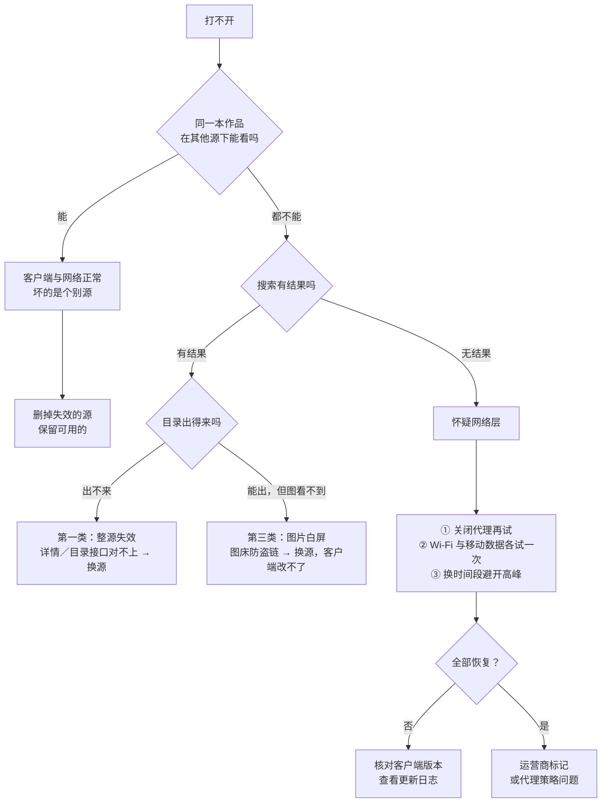

# 漫画阅读器图源：判断、分类与排障

一套与具体客户端无关的图源可用性判断方法。

> **站点最新网址：[yiciyuanapp.site](https://yiciyuanapp.site)**
> 若旧域名失效，以此为准。本仓库同时作为该地址的发布页。

> **本仓库不提供、不收录、不索引任何具体图源地址。** 这里只有判断方法和故障分类。
> 图源地址的获取与合法性由使用者自行负责。

---

## 这个仓库解决什么问题

漫画阅读器本身不含内容，它只是「按配置去取数据」的客户端。所以用户遇到的绝大多数问题
——搜不到、点开空白、图片白屏、章节缺图——都不是客户端故障，而是**图源这一侧**的状态问题。

但社区里流通的排查方式基本靠猜：重装、换机、清缓存、装更多源。这些动作对上面四类问题
里至少三类是无效的，因为它们针对的是「客户端」，而问题在「配置」。

本仓库把这件事拆成可判定的步骤：

1. 图源在语义上是什么，为什么会失效（[§1](#1-图源是什么)）
2. 怎么用三个硬指标在 30 秒内判断一个源能不能用（[§3](#3-三个硬指标可用性判据)）
3. 失效的四种类型，以及为什么它们的处理方式完全不同（[§4](#4-失效四分类)）
4. 一张「看到什么症状就做什么」的对照表（[§6](#6-症状速查表)）
5. 什么时候可以决定删掉一个源（[§7](#7-什么条件下可以删源)）

在线版（含界面截图）：[图源导入教程](https://yiciyuanapp.site/guide.html)

---

## 适用范围

**适用**

- 采用「外置配置 + 按配置抓取站点」架构的漫画 / 小说阅读器
- 用户已经导入若干图源，但无法判断哪些还能用
- 需要一份可复用的判断流程，而不是某个客户端的分步操作指南

**不适用**

- 内置内容、不需要配置的阅读器（没有「图源」这个概念）
- 需要具体图源地址的场景（本仓库明确不涉及）
- 客户端本身的 Bug（本文只帮你把它和「源的问题」区分开，不负责修）

---

## 1. 图源是什么

把阅读器想成一个遥控器，图源就是频道列表。遥控器本身没有节目，插上什么频道就放什么。

技术上，一份图源配置在语义上必然包含四类信息：

| 语义环节 | 作用 | 失效后果 |
|---|---|---|
| **搜索入口** | 去哪个站点、用什么地址和参数查询关键词 | 搜不到任何结果 |
| **结果解析** | 从返回的页面 / 响应里提取书名、封面、详情页链接 | 搜到了但列表是空的或错乱 |
| **目录接口** | 从详情页取得章节列表 | 点开详情页一片空白 |
| **图片地址** | 从章节页取得每一页图片的真实地址 | 有目录，点进去白屏 |

不同客户端的具体字段名、嵌套层级、是否区分搜索与详情两套规则，都不相同。
本仓库不针对任何特定客户端的 schema —— 但上面这四个环节是所有图源都必须具备的，
缺任何一个，对应的功能就一定不工作。**排障时按这四个环节定位，比记某个客户端的字段名更耐用。**

由此可以直接推出两个常见困惑的答案：

- **为什么刚装好打开是空白的？** 没有导入任何图源，频道列表为空，不是软件坏了。
- **为什么一个源会突然失效？** 它指向的站点改版、换域名、加访问验证或关站了，
  四个环节里至少有一个对不上了。

---

## 2. 三种来源形态

| 形态 | 做法 | 优点 | 主要风险 |
|---|---|---|---|
| **网络导入** | 复制链接或扫二维码，客户端在线拉取 | 一次可批量导入多个 | 分享者的链接随时失效 |
| **文件导入** | 下载 `.txt` / `.json` 文件，从「本地导入」载入 | 原始文件在手，重装、换设备可直接复用 | 文件本身可能已过期 |
| **自行编写** | 按客户端要求的格式手写配置 | 可针对特定站点，可控性最高 | 需要能看懂网页请求 |

**实用组合：网络导入求方便，文件导入做备份。**
导入成功后把原始文件另存一份，换设备时不需要再回社区找链接——那些链接大概率已经死了。

---

## 3. 三个硬指标（可用性判据）

不要看到「最新图源」「图源大全」就整包导入。一个新源进来，按顺序测这三项：

| # | 指标 | 怎么测 | 不通过的含义 |
|---|---|---|---|
| 1 | **搜得到吗** | 随便搜一本热门作品，该源下有无结果 | 搜索入口或结果解析已失效 |
| 2 | **目录出得来吗** | 点进详情页，章节列表能否加载 | 目录接口已失效 |
| 3 | **图显示得出来吗** | 点开第一章，图片能否显示、是否过慢 | 图片地址环节失效，或图床限制 |

**三项全过才算可用，必须依次通过。**

只过前两项的源非常常见：能搜、能看目录，点进去全是白图。这类源的实际价值为零，
但因为它「看起来是好的」，很多人会一直留着，然后在真正阅读时反复受挫。
第 2 项和第 3 项之间是这类源最集中的失效点。

> 单本测试的样本量不够。判断一个源是否值得长期保留，应**随机抽三本不同的作品**各测一遍，
> 三本全过才算通过。一本书失败可能只是那本书在该源被下架（见 §4 第二类），不是源坏了。

---

## 4. 失效四分类

同一个「打不开」，背后是四种不同的毛病。**只有第一类需要检查网络和客户端**，
其余三类都只能靠换源解决——这是本文最有实用价值的一条结论。

### 第一类：整源失效

该源下所有作品都搜不到，或搜到了点开全空白。

**原因**：源指向的站点停服、换域名、或新增了访问验证（Cloudflare 校验、登录墙等）。
四个环节可能全部对不上。

**处理**：这个源已死，删除，找替代。
**注意**：如果**所有**源同时失效，才需要怀疑网络或客户端——见 §5。

### 第二类：单本失效

源本身正常，别的作品都能看，只有某一本打不开。

**原因**：该作品在这个源对应的站点被删除或下架。不是源的问题。

**处理**：换一个源看这本。不要因为一本书删掉整个源。

### 第三类：图片白屏

目录能出来、章节能点开，但图片是白的或者一直转圈。

**原因**：图床启用了防盗链（`Referer` 校验）。图片地址本身有效，但客户端发起请求时
`Referer` 头不符合图床的白名单要求，图床返回 403 或空内容。

**处理**：**客户端侧无法解决。** 这类问题不能通过重装、清缓存、换网络修好，
因为请求被拒是图床的服务端策略，不是客户端的故障。只能换源。

判断依据很明确：目录接口是通的（说明站点可访问），只有图片环节失败——两个环节分离，
就能定位到图床这一层。

### 第四类：章节缺图

前面几章正常，中间某几章点进去没内容，或只有部分页。

**原因**：源对应的站点自身数据缺失，或该章节的抓取规则对不上当前页面结构。

**处理**：同样无法在客户端侧修。换源，或换一个站点看这几章。

### 四类的处理路径对照

| 类型 | 客户端责任 | 网络责任 | 唯一有效动作 |
|---|---|---|---|
| 整源失效（单源） | 无 | 无 | 删源、换源 |
| 整源失效（全部源） | 待查 | 待查 | 见 §5 排障流程 |
| 单本失效 | 无 | 无 | 换源看这本书 |
| 图片白屏 | **无** | 无 | 换源 |
| 章节缺图 | **无** | 无 | 换源 |

---

## 5. 排障决策树

**第一步永远是换源验证，不是重装。**

拿同一本作品，在搜索结果里看它出现了几个来源（这类客户端的结果通常按源分组，
同一本书会在多个源下各出现一次），逐个点开：

- 有一个能正常读 → 客户端、网络、账号都没有问题，坏的只是那几个源
- 全部打不开 → 问题在你这一端，继续往下走

换源验证能砍掉大约八成的误判。绝大多数人以为是软件坏了，实际上只是装的那几个源都过期了。

---

## 6. 症状速查表

| 症状 | 大概率原因 | 处理 |
|---|---|---|
| 搜索没有任何结果 | 网络不通，或所有源均已失效 | 先按 §5 查网络，再换源 |
| 搜得到，点开详情页空白 | 详情 / 目录接口失效 | 换源 |
| 有目录，点章节白屏或转圈 | 图床防盗链（`Referer` 校验） | 换源，客户端侧无法解决 |
| 只有某几章没图 | 源侧数据缺章 | 换源 |
| 昨天正常，今天全挂 | 源站点停服或更换域名 | 删源，找替代 |
| 图片模糊、压缩严重 | 源使用低清图源 | 换源；不影响功能，只影响观感 |
| 加载很慢但最终能出图 | 高峰期限速或跨境链路 | 换时段；不是源失效 |
| 部分源可用、部分不可用 | 正常的源保质期差异 | 无需处理，清理失效的即可 |

> 这张表可以直接当排障入口用。完整说明见 [`docs/symptom-table.md`](docs/symptom-table.md)。

---

## 7. 什么条件下可以删源

删源不需要凭感觉判断，满足以下**全部三条**就可以删：

1. **连续三天**都是同样的失败状态（排除临时抖动与服务端短时故障）
2. **更换不同作品**测试后仍然失败（排除第二类「单本失效」的误判）
3. **清空客户端缓存后重进**依然失败（排除本地缓存残留）

三条同时成立，说明这个源的配置已经和源站点的实际结构长期不匹配，没有保留价值。

反过来，**只满足其中一条就删源是常见错误**：只测了一本书、只看了一次、
或者没清缓存就下结论，会把本来可用的源删掉，然后再去社区重新找一遍。

---

## 8. 安全边界

图源本身是配置数据，正常情况下不含可执行代码。但有两件事不要做：

**一、不要安装来源不明的安装包。**

有人会把「图源包」打包成安装包（`.apk` 等）传播。那不是图源，那是另一个程序。
图源只应通过 `.txt` / `.json` 这类数据文件导入。任何要求你「先装一个工具才能用图源」的说法，
都应当视为风险。

**二、不要在图源相关页面输入账号密码。**

正常的图源配置不需要你做任何登录或授权。任何要求填写账号、扫码授权、绑定手机号的「图源」，
都应当直接放弃。

---

## 9. 常见误区

| 误区 | 实际情况 |
|---|---|
| 源装得越多越好 | 数量与可用性无关。一次导入几百个的结果是搜索变慢、失效源污染结果、出问题无法定位 |
| 「图源大全」合集可信 | 合集被反复转载，最早版本可能是一年前的。图源保质期短，转载次数越多失效比例越高 |
| 打不开就重装客户端 | 四类失效里至少三类与客户端无关，重装无效 |
| 清缓存能修白屏 | 白屏是图床服务端策略，本地缓存清不掉 |
| 找到好源就一劳永逸 | 任何源都会失效，时间早晚而已。追更的作品不要只挂在一个源上 |

---

## 术语

关键概念见 [`docs/glossary.md`](docs/glossary.md)。

---

## 内容核验

- 最后核验：**2026-11-16**
- 方法来源：对四类失效的复现与定位，以及多源交叉验证的实测
- 本文档不随客户端版本更新而变动，因为它描述的是图源架构层面的判断方法，
  而非某个客户端的界面操作

发现错误请开 Issue，附上可复现的现象描述。不接收图源地址的投稿或补充请求。

---

## 在线版与其他页面

本仓库内容与站点在线版同步维护，在线版含界面截图与分步操作：

- [图源导入教程](https://yiciyuanapp.site/guide.html) — 网络 / 扫码 / 本地导入的具体操作
- [图源失效排查](https://yiciyuanapp.site/yuantu-error.html) — 已导入但打不开的完整排障流程
- [图源从哪来、怎么筛选](https://yiciyuanapp.site/yuantu-source.html) — 三种来源形态与筛选维度

---

## 许可

文档内容采用 [CC BY 4.0](LICENSE) 许可。转载、摘编、翻译均可，**需保留出处链接**。
